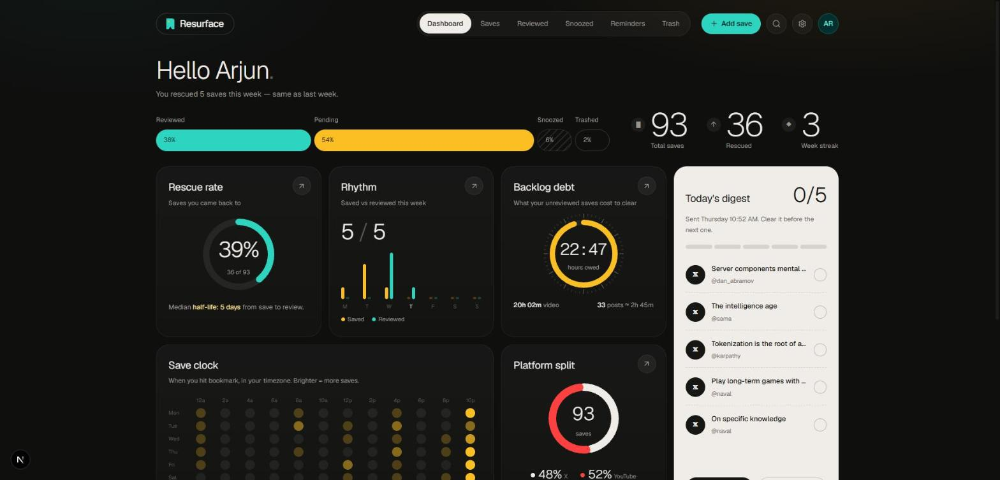

# Resurface

**Your saves, actually acted on.**

Resurface catches what you bookmark on X and YouTube, organises it, and brings it back to you in a short email digest — so "save for later" stops meaning "never".



---

## Why

Every bookmark is a small promise to come back. Platforms make saving effortless and returning nearly impossible: X bookmarks are a flat, unsearchable list, and YouTube's Watch Later quietly grows forever. Saving *feels* like doing something, so the urgency to act disappears.

Tools like Pocket, Readwise or Notion clippers are built for articles and highlights, not tweets and videos. Resurface closes that loop for the two places most people actually save things.

## How it works

```
Save on X / YouTube ─▶ Extension captures it ─▶ Dashboard organises it ─▶ Digest brings it back ─▶ You act on it
```

1. **Capture** — a Chrome extension notices when you bookmark a post on X or save a video on YouTube, captures it silently and offers a quick topic or reminder. Failed saves are queued and retried; the popup shows when each platform last captured, so a broken capture is noticed.
2. **Organise** — a web dashboard with every save in one place, auto-tagged into topics, filterable by platform, status and topic. Review, snooze, remind or trash.
3. **Resurface** — a daily or weekly email with the five saves most worth your time, on your days, at your time, in your timezone. Each item has one-click **Open**, **Mark reviewed** and **Snooze 1 day** buttons. Reminders arrive by email at the time you picked.

## The dashboard

The home screen is about your habits, not a list:

| Card | What it tells you |
|---|---|
| **Rescue rate** | Share of your saves you actually came back to, and the median time from save to review |
| **Rhythm** | Saved vs reviewed for each day this week |
| **Backlog debt** | Hours of video plus estimated reading time sitting in your queue |
| **Digest queue** | This digest's five saves, ticked off as you clear them, and when the next one goes out |
| **Save clock** | Weekday × time-of-day heatmap of when you hit bookmark |
| **Platform split** | X vs YouTube, and which one you actually follow through on |
| **Topic drift** | Your top topics week by week over the last two months |
| **Graveyard** | Saves untouched for 30+ days, with one click to put reminders on them |
| **Who you save** | Authors you save most, and how many of their posts you reviewed |

Plus a status bar (reviewed / pending / snoozed / trashed), total saves, rescued count and your weekly review streak.

## Features

- Chrome MV3 extension for X and YouTube, paired with a long-lived (~6 month) token, offline retry queue and reconnect prompt
- Rule-based topic suggestions (no AI key needed)
- Snooze (auto-returns when it ends), reminders, trash with 15-day purge
- Scheduled digests — daily or weekly — with branded emails and signed one-click actions
- Notification preferences, data export, account deletion, privacy policy
- Email/password auth with an optional invite-only mode and an admin page for the waitlist
- Runs entirely on free tiers

## Tech stack

| Layer | Tech |
|---|---|
| Web | Next.js 16 (App Router), React Query, Zustand, Tailwind CSS v4 |
| API | Node.js, Express 5, Prisma 7, PostgreSQL |
| Extension | Chrome Manifest V3, TypeScript |
| Email | Resend (SMTP fallback) |
| Hosting | Vercel (web), Render (API), Supabase (Postgres), cron-job.org (scheduler) |
| CI | GitHub Actions — lint, build, unit tests, Vercel deploy |

## Run your own for $0

Every service above has a free tier that comfortably covers one person. [docs/go-live.md](docs/go-live.md) walks through it end to end: Render environment, Resend, the cron job, your account and the extension. Supporting guides: [cron-setup.md](docs/cron-setup.md), [resend-email-setup.md](docs/resend-email-setup.md), [chrome-web-store.md](docs/chrome-web-store.md).

## Local development

Needs Node.js 20+ and npm 10+. No Docker or Postgres install — `npm run db:local` runs a real Postgres from the `embedded-postgres` package.

```bash
git clone https://github.com/Adarsh1313/resurface.git
cd resurface
```

**1. Database** (terminal 1, leave running)

```bash
cd backend
npm install
cp .env.example .env
npm run db:local            # Postgres on localhost:5433, data in backend/.pgdata
```

**2. API** (terminal 2)

```bash
cd backend
npx prisma migrate deploy
npx prisma db seed          # demo user with ~10 weeks of history
npm run dev                 # http://localhost:4000  (health: /ready)
npm test                    # unit tests
```

Without `RESEND_API_KEY`, emails are printed to this terminal. The API also runs the scheduler every minute locally; production uses `/v1/cron/tick`.

**3. Web** (terminal 3)

```bash
cd web
npm install
echo NEXT_PUBLIC_API_BASE_URL=http://localhost:4000/v1 > .env.local
npm run dev                 # http://localhost:3000
```

Log in with `demo@resurface.app` / `password123`.

**4. Extension**

```bash
cd extension
npm install
npm run build:local         # points at localhost; `npm run build` targets production
```

In `chrome://extensions`, turn on Developer mode, **Load unpacked** → the `extension/` folder. Generate a token in Settings → Extension and paste it into the popup.

## Repository

```
resurface/
├── web/         Next.js app — landing, dashboard, settings
├── backend/     Express API, Prisma schema + migrations, scheduler, email templates
├── extension/   Chrome MV3 extension
├── docs/        Go-live, cron, email and Web Store guides
└── _design/     Design references and the dashboard mockup
```

## What's next

Built and running for personal use. Next, depending on whether others want it:

- Google sign-in
- Chrome Web Store listing
- Verified email domain so digests can go to anyone
- Full-text search and saved views
- AI topic tagging and digest summaries
- Mobile-friendly PWA

## License

MIT — see [LICENSE](LICENSE).

---

Built by [Adarsh Bharathwaj](https://github.com/Adarsh1313).
